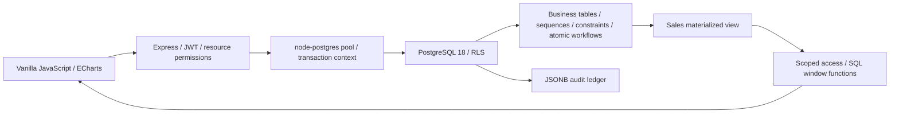
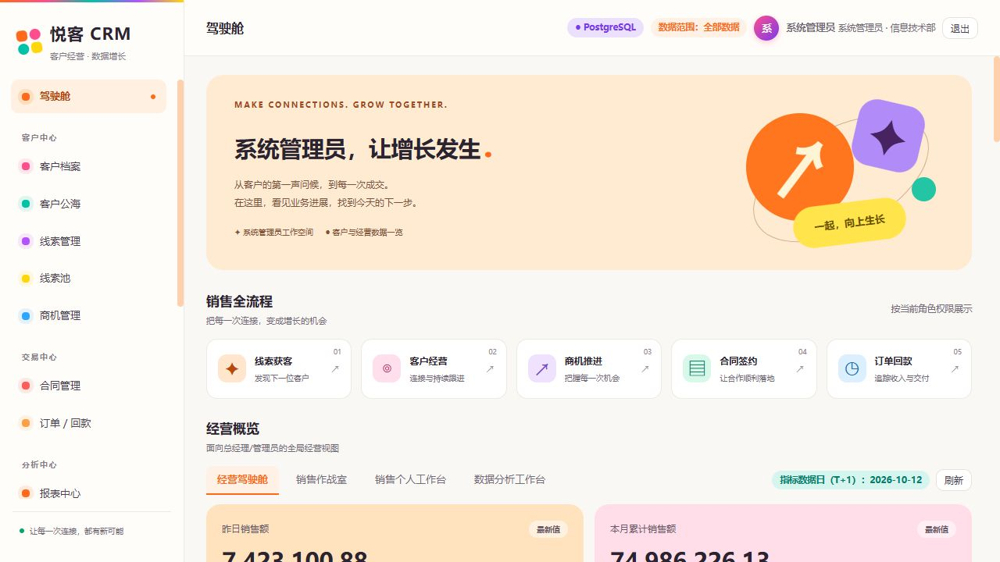
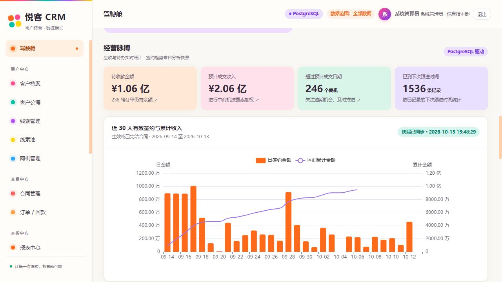
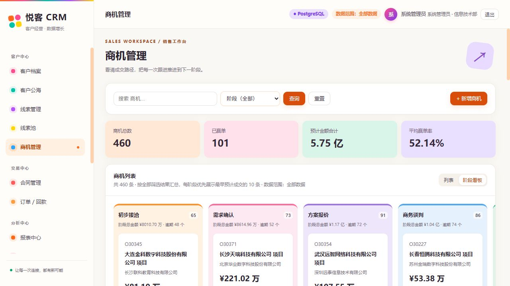
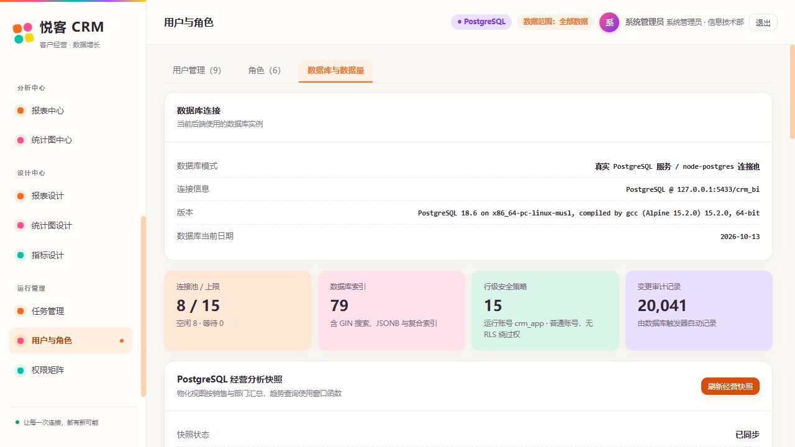

# Yueke CRM · Customer Operations and Business Intelligence

[Bilingual home](README.md) · [中文说明](README.zh-CN.md)

A CRM and BI demo for sales representatives, directors, general managers, customer service and analysts. Customers, leads, opportunities, contracts, orders and payments share a business model, with role-specific dashboards connecting sales activity to business analytics. The interface uses orange, pink, mint, purple and yellow accents and supports narrow-screen navigation. The application UI is currently Chinese.

The default environment connects to a **standalone PostgreSQL 18 server** through a `node-postgres` connection pool. Screenshots and tests use generated demo records. Database files, backups and local credentials are excluded from the repository.

## Features

| Module | Implemented behavior |
| --- | --- |
| Role dashboards | Authorized menus, KPI cards, charts and reports; all, department and personal data scopes |
| Customer operations | Customer profiles, contacts, a customer 360 view, follow-up history and next-contact time |
| Shared customer and lead pools | Claim/release prospects, claim/assign leads, convert a lead into a customer and contact |
| Opportunities | List and stage board; totals cover all matching records, with up to 10 opportunities per stage prioritized by earliest expected close date |
| Contracts, orders and payments | Contract values and costs, orders, partial payments, settlement state and overpayment prevention |
| Business pulse | Live receivables, weighted opportunity forecasts, overdue opportunities and due follow-up records; 30-day active-contract sales and running totals |
| Self-service BI | Grouping, aggregation, formula fields, filtering, pagination and CSV export; 11 chart types |
| T+1 metrics and jobs | 12 demo metrics, 120-day backfill, scheduled/manual execution, previews and logs |
| Administration | Users, roles, permission matrix, live PostgreSQL version, pool statistics, indexes, RLS policies, audit counts and an actual query plan |

Due follow-ups count historical records whose `next_time` has elapsed; a completion/closure workflow is not implemented. The sales snapshot includes effective or closed contracts, so its figures can differ from reports that include other contract states.

## PostgreSQL capabilities in use

| Capability | Purpose |
| --- | --- |
| Pooling, timeouts and transaction-local settings | Reuse connections and set verified user, department and scope for each transaction without leaking settings into the next request |
| Row-Level Security | Enforce record visibility in the database; `crm_app` has neither superuser nor BYPASSRLS privileges |
| Sequences | Allocate globally unique business codes under concurrent inserts |
| PL/pgSQL and row locks | Atomically create the customer/contact and update the lead; concurrent conversions cannot create duplicate customers |
| CHECK constraints, foreign keys and triggers | Validate amounts and rates; direct SQL cannot overpay an order or reduce its value below collected payments; payment changes synchronize settlement state |
| `pg_trgm` and GIN | Indexed expressions for parameterized, case-insensitive customer and lead substring searches |
| JSONB | BI configuration and database-triggered before/after audit data; the application role cannot directly modify the audit ledger |
| Materialized views | Pre-aggregate effective/closed contracts by day, owner, department and region; expose results through a scoped access function |
| Window functions | Running sales totals, previous-day values, and per-stage ranking and row limits |
| Concurrent refresh and advisory locks | Refresh snapshots while keeping reads available; source/refreshed versions detect later changes |
| Migrations, ANALYZE and EXPLAIN | Checksummed migrations, non-destructive repeat initialization and visible real query plans |

RLS is an additional SQL scope check behind a trusted backend, not separate authentication for each end user. Keep database credentials on the backend: it supplies transaction-local business identity. Database administrators retain administrative access. With a small demo dataset, sequential scans can be the optimizer's appropriate choice; the UI shows the observed plan rather than promising a fixed speedup.

## Architecture



## Quick start

Install **Node.js 22+, npm, and Docker Desktop or Docker Engine with Compose**, and start Docker.

```sh
git clone https://github.com/Crazy4Lamb/crm-bi.git
cd crm-bi
npm ci
npm run setup
npm start
```

Open [http://127.0.0.1:8787](http://127.0.0.1:8787). On first run, setup creates an untracked `.env` with random database/JWT secrets, starts a project-specific PostgreSQL 18 instance, applies migrations and seeds demo data. PostgreSQL binds only to `127.0.0.1:5433`, leaving an existing port-5432 service intact. Data persists in a named Compose volume.

Running setup again applies new migrations and skips seeding when records exist. Initialization does not drop tables or reset users/business data. Applied migrations are checksummed; add a new migration rather than editing an applied one.

### Demo accounts

| Account | Password | Role | Scope |
| --- | --- | --- | --- |
| `admin` | `admin123` | Administrator | All |
| `gm01` | `123456` | General manager | All |
| `dir01` | `123456` | Sales director | North China department |
| `rep01` / `rep02` / `rep03` / `rep04` | `123456` | Sales representatives | Personal |
| `ana01` | `123456` | Analyst | All |
| `svc01` | `123456` | Customer service | Personal |

Demo credentials are public examples. Use your own accounts and secrets, configure appropriate access scopes and arrange backups before deploying a business environment.

## Configuration and maintenance

See `.env.example`. `PGHOST`, `PGPORT`, `PGDATABASE`, `PGUSER` and `PGPASSWORD` configure the ordinary runtime role; `PGADMIN_USER` and `PGADMIN_PASSWORD` configure migrations. `APP_TZ` defaults to `Asia/Shanghai`, the pool limit is 15 and the statement timeout is 15 seconds.

For another PostgreSQL 18 server, prepare a dedicated database and migration role, update `.env`, run `node scripts/create-app-role.js` to prepare the ordinary role, then run `npm run initdb`. The migration role needs extension/schema/function creation and grant privileges. Unmanaged existing tables are not silently adopted. If using connection URLs, set both `DATABASE_URL` and `MIGRATION_DATABASE_URL`. The server uses only the ordinary role after migration.

```sh
npm run db:up       # Start only the project's Docker database
npm run db:migrate  # Apply migrations without seeding
npm run db:backup   # Docker pg_dump backup to data/backups/*.dump
docker compose down # Stop project services, preserving the data volume
```

Backups use the `pg_dump -Fc` format and can be restored with `pg_restore` into another prepared database. There is no one-click restore that overwrites an existing database. Use a connection-appropriate `pg_dump` for external databases.

Administrators can refresh sales snapshots under **Users and Roles → Database and Data Volume → Refresh Business Snapshot**. Successful scheduled jobs also refresh the snapshot. Business changes mark it as pending refresh.

Explicit `DB_MODE=pglite` enables a portable demo mode. It does not provide the server-specific PostgreSQL features above and is not the default environment.

## Validation

With the application running:

```sh
npm test          # 61 smoke checks + 35 CRM workflow/permission checks
npm run test:pg   # 31 real PostgreSQL checks
```

The PostgreSQL suite covers direct-SQL RLS, rollback, concurrent codes/conversions/payments, database constraints, pool isolation, snapshot refresh and window totals. It creates and cleans up separate test fixtures. The smoke suite executes a demo T+1 job and creates job logs; run it against a demo or test database.

GitHub Actions uses an isolated PostgreSQL 18 service to run the suites and verify repeat initialization. Local acceptance includes **127 API/database checks**. Screenshots show the running application.

## Project layout

```text
server/db/schema.sql          Initial baseline, without DROP TABLE
server/db/migrations/         PostgreSQL business rules, RLS, indexes and maintenance
server/db/migrate.js          Checksummed migrations and runtime grants
server/db/context.js          Request business identity context
server/services/              Reports, charts, metrics, insights and scheduling
server/routes/                CRM, BI and authorization endpoints
web/                         No-build frontend and local ECharts bundle
scripts/                     Setup, backup and regression checks
docker/ compose.yaml          Dedicated PostgreSQL service
docs/screenshots/            Actual application screenshots
```

## Screenshots

### Colorful role dashboard



### Receivables and cumulative sales



### Opportunity totals across all matching records



### Live PostgreSQL instance and database capabilities



## References

- [PostgreSQL Row Security](https://www.postgresql.org/docs/18/ddl-rowsecurity.html)
- [pg_trgm](https://www.postgresql.org/docs/18/pgtrgm.html)
- [Materialized view refresh](https://www.postgresql.org/docs/18/sql-refreshmaterializedview.html)
- [Official PostgreSQL Docker image](https://hub.docker.com/_/postgres)
- [Apache ECharts](https://echarts.apache.org/)
