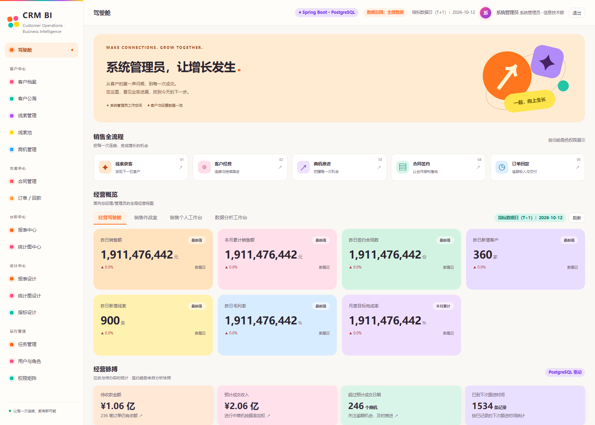
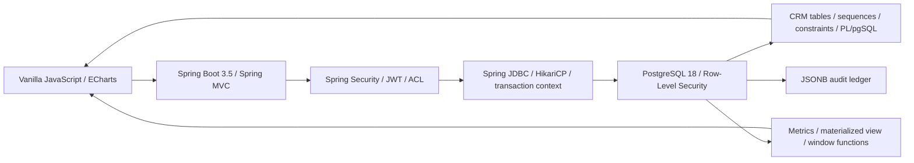
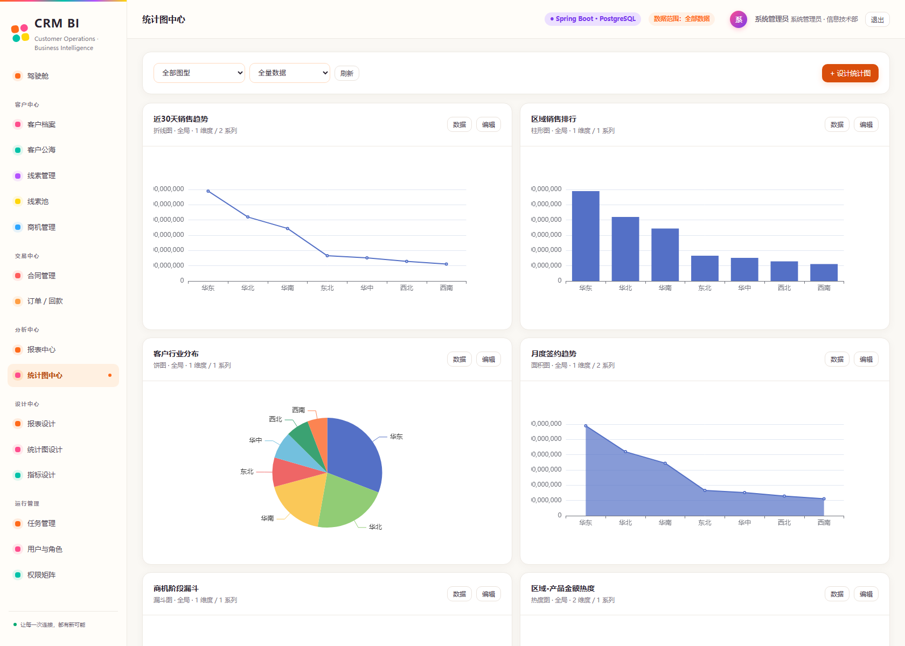
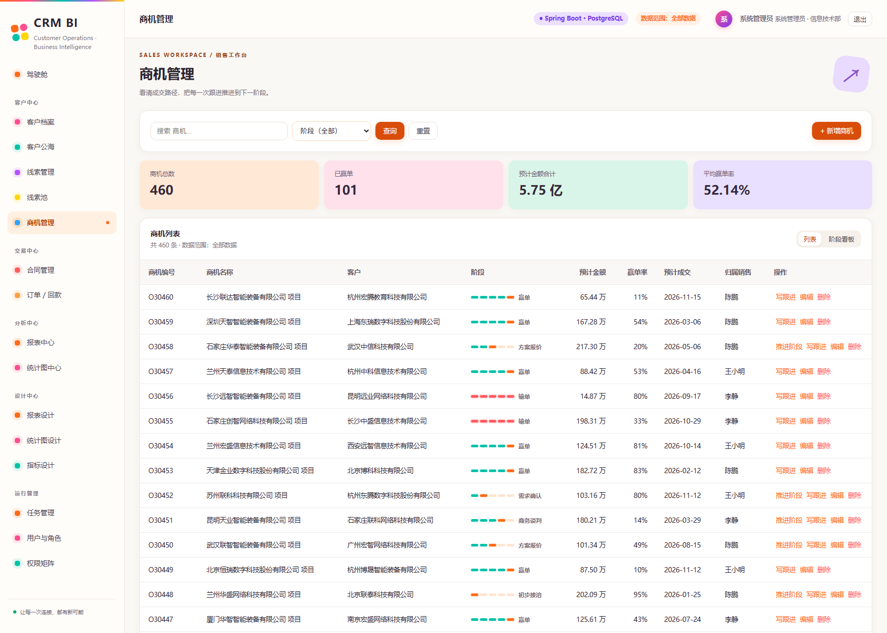
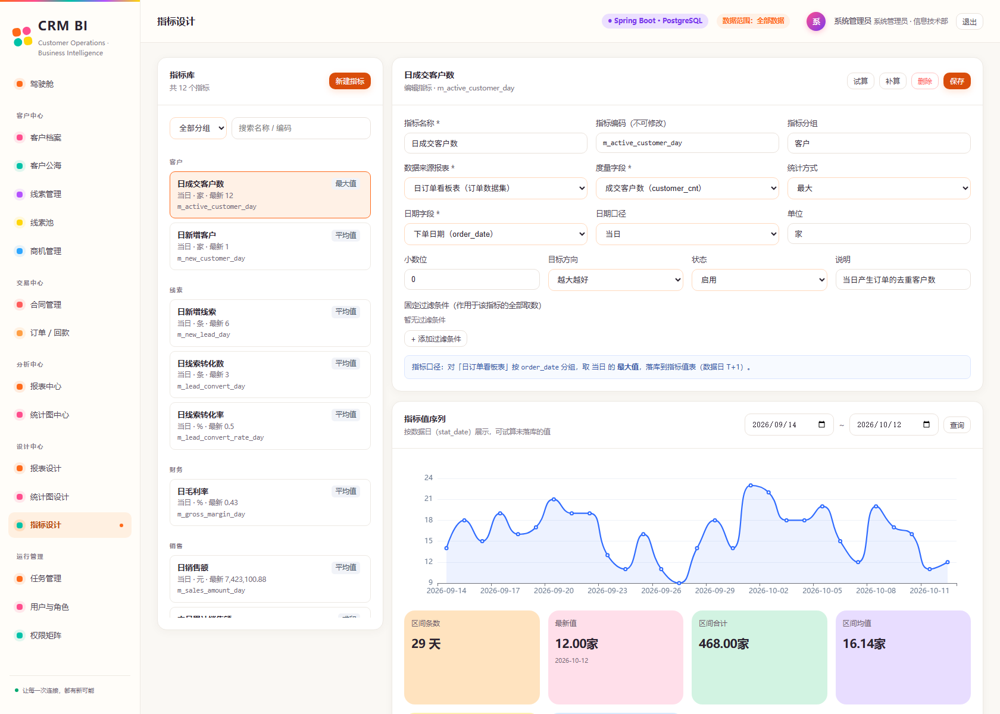

# CRM BI

**Spring Boot 3.5 + Java 21 + PostgreSQL 18** 驱动的 CRM 与 BI 分析平台。系统把线索、客户、商机、合同、订单、回款和跟进串成客户全旅程，并通过角色驾驶舱、报表、指标和经营分析形成实时数据联动。

A **Spring Boot 3.5, Java 21 and PostgreSQL 18** CRM and business intelligence platform. It links leads, customers, opportunities, contracts, orders, payments and follow-ups into one customer journey, then exposes the same data through role dashboards, reports, metrics and business analytics.

[中文说明](README.zh-CN.md) · [English guide](README.en.md)



## 核心能力 / Highlights

- 客户 360 展示从线索、商机、合同、订单到回款的统一业务旅程，并汇总签约、已收和待收金额。
- 客户公海、线索池、领取与分配、商机阶段、合同、订单、分次回款和跟进闭环。
- 按系统管理员、总经理、销售总监、销售代表、分析师和客服装配菜单、卡片、图表与数据范围。
- PostgreSQL RLS 在数据库层实施本人、部门、全部数据范围；Spring JDBC 在每个事务写入经过认证的业务上下文。
- PostgreSQL 序列、PL/pgSQL、行锁、约束、触发器、JSONB 审计、GIN、物化视图和窗口函数参与真实业务处理。
- 12 个 T+1 指标按各自口径计算；定时任务使用 PostgreSQL system 数据范围、事务级 advisory lock，并支持单日计算、滚动补算和无删除的归档检查。
- 多巴胺配色的原生 JavaScript + ECharts 前端，由 Spring Boot 作为静态资源和 API 一并发布。

## 架构 / Architecture



## 快速开始 / Quick start

准备 Node.js 22+、npm 和 Docker Desktop（或 Docker Engine + Compose）。Java 与 Maven 由多阶段 Docker 构建提供，本机不需要另行安装。

Install Node.js 22+, npm, and Docker Desktop or Docker Engine with Compose. Java and Maven are supplied by the multi-stage Docker build.

```sh
git clone https://github.com/Crazy4Lamb/crm-bi.git
cd crm-bi
npm ci
npm run setup
```

打开 [http://127.0.0.1:8787](http://127.0.0.1:8787)。`setup` 会生成未跟踪的随机本地密钥、启动 PostgreSQL 18、应用增量迁移、生成演示数据并构建 Spring Boot 容器。数据库仅映射到 `127.0.0.1:5433`，应用映射到 `127.0.0.1:8787`。

Open [http://127.0.0.1:8787](http://127.0.0.1:8787). Setup creates untracked random local secrets, starts PostgreSQL 18, applies migrations, seeds demo data, and builds the Spring Boot container.

| Account | Password | Role / 角色 | Scope / 范围 |
| --- | --- | --- | --- |
| `admin` | `admin123` | 系统管理员 / Administrator | 全部 / All |
| `gm01` | `123456` | 总经理 / General manager | 全部 / All |
| `dir01` | `123456` | 销售总监 / Sales director | 部门 / Department |
| `rep01`–`rep04` | `123456` | 销售代表 / Sales representative | 本人 / Personal |
| `ana01` | `123456` | 数据分析师 / Analyst | 全部 / All |
| `svc01` | `123456` | 客服 / Customer service | 本人 / Personal |

```sh
npm start          # build and start the Spring Boot app container
npm stop           # stop app and database containers
npm run db:up      # start only PostgreSQL
npm run db:migrate # apply checksummed migrations
npm run db:backup  # create data/backups/*.dump with pg_dump -Fc
npm test           # 66 smoke + 37 CRM workflow/permission checks
npm run test:pg    # 31 PostgreSQL-specific checks
```

## 项目结构 / Project layout

```text
src/main/java/                 Spring Boot API, security, ACL and business services
src/main/resources/            Spring configuration
web/                           No-build frontend and local ECharts bundle
server/db/                     Schema, checksummed migrations and seed tooling
server/services/               Node-only initialization/backfill helpers
scripts/                       Setup, backup and end-to-end regression scripts
Dockerfile                     Java 21 multi-stage production image
compose.yaml                   Spring Boot app + dedicated PostgreSQL 18
.github/workflows/ci.yml       Java build and 134 integration checks
```

Node.js is retained for database initialization and black-box integration tests. Runtime HTTP requests are served by Spring Boot; there is no Express server entry point.

## Screenshots

| 经营分析 / Business pulse | 商机阶段 / Opportunity board |
| --- | --- |
|  |  |



## References

- [Spring Boot reference](https://docs.spring.io/spring-boot/)
- [Spring Security reference](https://docs.spring.io/spring-security/reference/)
- [PostgreSQL 18 Row Security](https://www.postgresql.org/docs/18/ddl-rowsecurity.html)
- [PostgreSQL `pg_trgm`](https://www.postgresql.org/docs/18/pgtrgm.html)
- [Apache ECharts](https://echarts.apache.org/)
