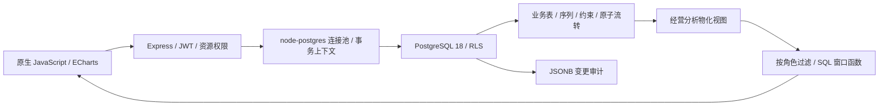

# 悦客 CRM · 客户经营与 BI 分析平台

[双语首页](README.md) · [English](README.en.md)

面向销售代表、销售总监、总经理、客服和数据分析师的 CRM + BI 演示项目。客户、线索、商机、合同、订单和回款共享一套业务数据，角色驾驶舱将业务流转与经营分析连接起来。界面采用橙、莓粉、薄荷绿、紫色和柠檬黄配色，支持窄屏导航。

默认接入**独立 PostgreSQL 18 服务**，通过 `node-postgres` 连接池访问。截图和测试使用自动生成的演示数据；仓库不包含数据库文件、备份或本地连接密码。

## 功能

| 模块 | 实际能力 |
| --- | --- |
| 角色驾驶舱 | 按角色展示菜单、KPI、统计图与报表；区分全部、部门、本人数据 |
| 客户经营 | 客户档案、联系人、客户 360、跟进时间轴、下次跟进时间 |
| 客户公海与线索池 | 潜在客户领取/退回，线索领取/分配；线索转化时创建客户和联系人 |
| 商机管理 | 列表和阶段看板；看板汇总全部筛选结果，每阶段优先展示最早预计成交的 10 条，显示阶段金额与逾期数量 |
| 合同、订单与回款 | 合同金额、成本、订单与分次回款；足额回款后推进付款状态，禁止超额回款 |
| 经营脉搏 | 实时应收余额、加权商机预测、逾期商机、已到跟进时间的记录；近 30 天有效签约和累计金额 |
| 自助 BI | 报表分组、聚合、公式字段、筛选、分页、CSV 导出；11 种统计图 |
| T+1 指标与任务 | 12 个演示指标、120 天回算、定时执行、试算、补算与执行日志 |
| 系统管理 | 用户、角色、权限矩阵、实际数据库版本、连接池、索引、安全策略、审计数量与查询计划 |

“已到跟进时间”统计历史跟进记录的 `next_time`，目前没有任务完成/关闭流程；签约分析快照只统计生效或已完结合同，和包含其他合同状态的报表口径可能不同。

## PostgreSQL 在哪里发挥作用

| 数据库能力 | 项目中的用途 |
| --- | --- |
| 连接池、超时、事务本地设置 | 复用连接；每个事务写入服务器验证后的用户、部门和数据范围，提交/回滚后清除 |
| Row-Level Security | 对客户、线索、商机、合同、订单、联系人、回款和跟进实施数据库层的可见范围；运行账号 `crm_app` 无超级用户或 RLS 绕过权 |
| 序列 | 全局生成业务编号，避免并发新增时 `MAX + 1` 冲突 |
| PL/pgSQL 与行锁 | `crm_convert_lead()` 将客户、联系人和线索关联放进一次原子操作，阻止重复转化 |
| CHECK、外键、触发器 | 校验金额和比例；数据库直接写入也不能超额回款或把订单金额降到已收款以下，回款增减同步付款状态 |
| `pg_trgm` 与 GIN | 客户和线索使用参数化、大小写不敏感的包含搜索；配套搜索表达式索引 |
| JSONB | BI 配置以及不可由运行账号直接改写的变更审计；保留前后数据和操作人 |
| 物化视图 | `bi_sales_daily` 按日期、销售、部门和区域预聚合生效/完结合同；只通过按范围过滤的函数读取 |
| 窗口函数 | 签约区间累计、上一日值；商机按阶段排名和限量展示 |
| 并发刷新与 advisory lock | 快照刷新保留读服务，并用版本号提示刷新后是否仍有新变更 |
| 增量迁移、ANALYZE、EXPLAIN | 迁移记录版本和校验和；初始化重复执行保留已有数据；管理员可看实际查询计划 |

RLS 是受信任后端之外的一层 SQL 数据范围校验，不是独立的终端用户数据库认证。数据库连接凭据只应由后端持有；业务身份通过后端设置的事务本地上下文传入。数据库管理员仍有管理权限。小规模演示数据上，优化器可能选择顺序扫描；界面显示本次实际计划，不承诺固定提速倍数。

## 架构



## 快速开始

准备 **Node.js 22+、npm、Docker Desktop 或 Docker Engine + Compose**，并启动 Docker。

```sh
git clone https://github.com/Crazy4Lamb/crm-bi.git
cd crm-bi
npm ci
npm run setup
npm start
```

打开 [http://127.0.0.1:8787](http://127.0.0.1:8787)。`setup` 首次生成未跟踪的 `.env` 和随机数据库/JWT 密钥，启动项目独立的 PostgreSQL 18，应用迁移并生成演示数据。数据库默认只映射到本机 `127.0.0.1:5433`；不占用已有的 5432 服务。数据保存在 Compose 命名卷中。

再次执行 `npm run setup` 会应用新迁移，检测到已有业务数据后跳过演示数据生成。初始化不删除表，也不重置用户或业务记录。修改已应用迁移会触发校验和错误，应新增迁移。

### 演示账号

| 账号 | 密码 | 角色 | 数据范围 |
| --- | --- | --- | --- |
| `admin` | `admin123` | 系统管理员 | 全部 |
| `gm01` | `123456` | 总经理 | 全部 |
| `dir01` | `123456` | 销售总监 | 华北部门 |
| `rep01` / `rep02` / `rep03` / `rep04` | `123456` | 销售代表 | 本人 |
| `ana01` | `123456` | 数据分析师 | 全部 |
| `svc01` | `123456` | 客服 | 本人 |

演示账号密码是公开的示例。部署自己的业务环境前，请使用自己的账号和密钥、配置所需的访问范围，并安排备份。

## 配置和数据库维护

`.env.example` 给出配置项。`PGHOST`、`PGPORT`、`PGDATABASE`、`PGUSER`、`PGPASSWORD` 用于普通运行账号；`PGADMIN_USER`、`PGADMIN_PASSWORD` 用于迁移。`APP_TZ` 默认 `Asia/Shanghai`，`PGPOOL_MAX` 默认 15，语句超时默认 15 秒。

接入其他 PostgreSQL 18 实例时先准备独立数据库和迁移账号，修改 `.env`，执行 `node scripts/create-app-role.js` 准备普通运行角色，再执行 `npm run initdb`。迁移账号需要创建扩展、表、函数和授权的权限；不托管未登记的已有表结构。使用连接 URL 时，同时配置 `DATABASE_URL` 和 `MIGRATION_DATABASE_URL`。迁移完成后，运行服务仅使用普通账号。

```sh
npm run db:up       # 只启动项目 Docker 数据库
npm run db:migrate  # 只执行增量迁移
npm run db:backup   # 使用项目 Docker 服务的 pg_dump，输出 data/backups/*.dump
docker compose down # 停止项目服务，保留数据卷
```

备份是 `pg_dump -Fc` 自定义格式，可通过 `pg_restore` 恢复到另一个已准备好的数据库；项目不提供会覆盖现有库的一键恢复。外部数据库的备份请直接使用适合该连接的 `pg_dump`。

经营快照可在 **用户与角色 → 数据库与数据量 → 刷新经营快照** 手动刷新。后台计划任务成功后也刷新快照；源数据变化会显示“快照待刷新”。

显式设置 `DB_MODE=pglite` 可使用便携演示模式；该模式不提供上述服务端 PG 专项能力，也不是默认环境。

## 测试

先启动应用，然后执行：

```sh
npm test          # 61 项冒烟 + 35 项 CRM 流转与权限检查
npm run test:pg   # 31 项真实 PostgreSQL 专项检查
```

PG 专项检查包括直接 SQL 的 RLS、事务回滚、编号并发、原子转化、数据库回款约束、连接复用、物化视图刷新与 SQL 窗口累计。测试创建独立的测试记录并清理；`npm test` 会执行演示 T+1 任务，产生任务日志。建议在演示或测试数据库运行。

`.github/workflows/ci.yml` 在独立 PostgreSQL 18 服务上运行两组测试，并验证重复初始化。当前本地验收共 **127 项接口/数据库检查**；截图来自实际运行环境。

## 目录

```text
server/db/schema.sql          首次建表基线（不含 DROP TABLE）
server/db/migrations/         PG 扩展、业务规则、安全策略与统计维护
server/db/migrate.js          版本与校验和迁移、运行角色授权
server/db/context.js          请求业务身份上下文
server/services/              报表、图表、指标、经营分析和调度
server/routes/                CRM / BI / 权限接口
web/                         无构建前端与本地 ECharts
scripts/                     安装、备份与回归检查
docker/ compose.yaml          项目独立 PostgreSQL 服务
docs/screenshots/            实际界面截图
```

## 实际界面

### 多巴胺驾驶舱


### 经营脉搏与 SQL 累计趋势


### 全量商机阶段统计


### 真实 PostgreSQL 实例与数据库能力


## 技术资料

- [PostgreSQL Row Security](https://www.postgresql.org/docs/18/ddl-rowsecurity.html)
- [pg_trgm](https://www.postgresql.org/docs/18/pgtrgm.html)
- [REFRESH MATERIALIZED VIEW](https://www.postgresql.org/docs/18/sql-refreshmaterializedview.html)
- [PostgreSQL 官方 Docker 镜像](https://hub.docker.com/_/postgres)
- [Apache ECharts](https://echarts.apache.org/)

